<div align="center">
  

  <h1>Prudence</h1>

  <p><strong>A local-first agent harness built for deliberate, observable execution.</strong></p>

  <p>
    Plan work, govern tool use, and delegate bounded tasks across Microsoft Foundry and
    OpenAI-compatible local models.
  </p>

  <p>
    <a href="LICENSE"></a>
    
    
    
  </p>

  <p>
    <a href="#quick-start">Quick start</a> &bull;
    <a href="#why-prudence">Features</a> &bull;
    <a href="#interface">Interface</a> &bull;
    <a href="#architecture">Architecture</a> &bull;
    <a href="docs/agent-framework-harness-capabilities.md">Framework capabilities</a> &bull;
    <a href="#contributing">Contributing</a>
  </p>
</div>

---

<p align="center">
  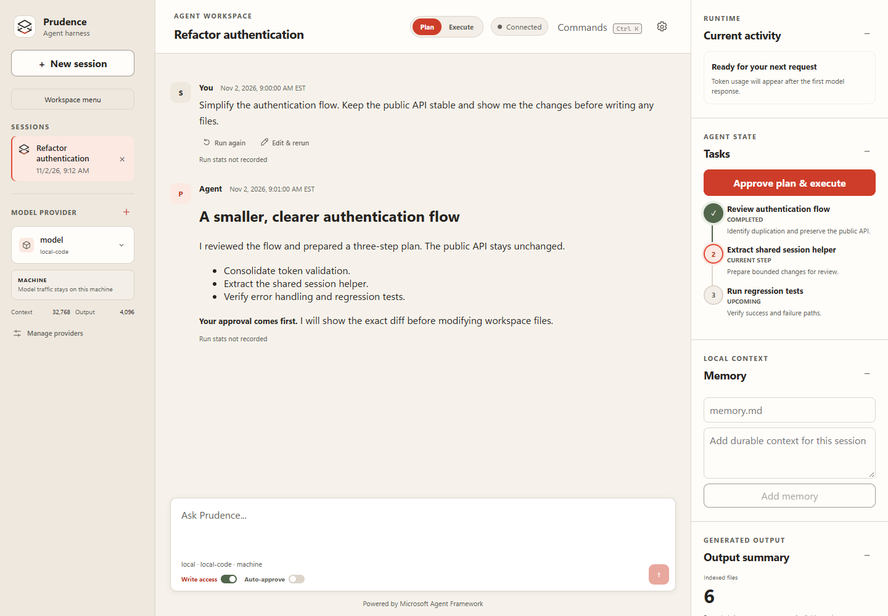
</p>

*Actual UI capture with synthetic local-provider and session fixtures; not a live model run.*

Prudence provides a controlled browser workspace for planning, tool use, approvals, and agent
delegation. Session data, tasks, events, and memory stay on the local machine by default;
workspace-scoped data remains with the bound project.

> [!NOTE]
> Prudence is under active development. Interfaces and persisted data formats may change before
> the first stable release.

## Why Prudence

| Local by default | Approval first | Extensible by design |
| :--- | :--- | :--- |
| Session state and memory remain on your machine or in the bound workspace. | Plans, tool calls, risk-aware diffs, and writes stay visible and governed. | Add instruction layers, skills, lifecycle hooks, MCP servers, and bounded subagents. |

### Core Capabilities

- **Flexible model access:** Configure Microsoft Foundry deployments and OpenAI-compatible local
  models, test connectivity, and import or export non-secret provider profiles.
- **Governed execution:** Review plans, approve individual tool calls, inspect risk-aware diffs,
  cancel runs, and recover sessions after a restart.
- **Workspace context:** Bind a project to enable bounded file search, file reads, Git inspection,
  artifacts, business notes, and optional approval-gated writes.
- **Agent extensibility:** Load layered instructions, reusable skills, declarative lifecycle hooks,
  trusted local stdio MCP servers, and constrained read-only subagents.
- **Counsel & Craft:** Pair a Microsoft Foundry reasoning agent with a serialized local model broker
  for bounded code and content microtasks.
- **Local persistence:** Store session state in SQLite, with workspace memory and metadata under
  `<workspace>\.prudence` when a session is bound.
- **Accessible browser UI:** Use streaming chat, persistent task progress, searchable commands,
  keyboard navigation, semantic live regions, and reduced-motion support.

## Interface

Prudence uses **Porcelain / Vermilion**: a warm porcelain canvas, light taupe sidebar,
chalk-white surfaces, ink typography, and restrained vermilion selections and actions.
The light appearance stays consistent even when the operating system prefers dark mode.

- The **Layered panes** mark represents transparency through two separated planes:
  balanced ink outlines, taupe connectors, and a restrained vermilion front edge.
  The same SVG is used for the default persona, the dial's reset option, the browser
  favicon, and this README. The mark stays sharp at small sizes without grayscale filters.
- Sessions and provider controls stay in the left sidebar.
- Each session carries the persona selected **when it was created**, shown as a symbol
  beside its title with an accessible name and hover label. Creation persona metadata
  persists in SQLite and portable archives; later dial changes never rewrite it.
  Older sessions and archives without that metadata are explicitly labeled
  **Creation persona not recorded**, not inferred from titles or current preferences.
- Session/provider deletion and replacement of an unsent draft use themed in-app
  confirmations, not browser/Windows popups. Cancel receives initial focus; Escape
  dismisses without stopping a run. Destructive actions show progress, block duplicate
  submissions, and retain errors in the dialog for explicit retry.
- Click the Prudence icon in the sidebar or welcome area to open a symbol-only radial
  persona dial. Hover for names; arrow keys move between choices, Enter/Space selects,
  and Escape dismisses. The center icon restores the default experience.

<p align="center">
  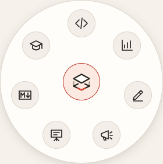
</p>

- Personas persist as a browser-local UI preference. They tailor welcome copy, composer
  guidance, and a collapsible task brief with starting points that load a draft, never
  send automatically. They do not change model selection, session instructions, tools,
  approval rules, or existing conversation content. Changing personas preserves drafts.
  New-session creation separately snapshots the current persona as historical metadata.
  This is the initial task-oriented UI layer, not a set of specialized editors.

| Persona / symbol | Task-oriented experience | Next specialized surface |
| :--- | :--- | :--- |
| Software Engineer / code brackets | Expected behavior, constraints, changes, verification | Diffs and test results |
| Business Intelligence / chart | Business questions, metric definitions, evidence and caveats | Dataset inspection and charts |
| Blogger / pen | Audience, angle, outline, draft, editorial review | Draft and revision comparison |
| Social Media / megaphone | Platform, audience, hooks and grounded variants | Channel previews; explicit publishing approval |
| Presentations / screen | Takeaway, story arc, slide messages and rehearsal | Slide storyboard and speaker notes |
| Markdown / Markdown mark | Document structure, examples, links and accuracy | Source / rendered preview |
| Learning Coach / graduation cap | Prior knowledge, learning goal, worked examples and practice | Learning path and understanding checks, not a research-results feed |

**Learning Coach** is the proposed name for the learning-focused Researcher persona.
Its starting points ask the agent to assess a baseline, teach interactively, and check
understanding one question at a time. These are explicit editable prompts, not hidden
model instructions or claims that learning progress has been measured.

- Command-palette actions independently collapse either sidebar: **Alt+V** for the left,
  **Ctrl+Alt+V** for the right. No dedicated header buttons; runs, drafts, and approvals stay intact.
- Model switching uses a compact in-app picker. **Manage providers** opens a centered
  dialog with profile inspection, grouped actions, and connectivity history without
  resizing the sidebar or switching the active model.
- Provider identities use distinct Foundry diamond and local cube symbols with accessible
  labels. Visible names omit redundant provider-type prefixes; stored profile names are unchanged.
  The sidebar shows one identity block, omitting the model subtitle when it duplicates the name.
- Conversation occupies the center, with **Plan / Execute** in the top bar for single-provider
  sessions. Counsel & Craft retains its existing mode behavior.
- Every user and agent message shows its recorded date and time, including seconds and the
  browser's time zone. Streaming responses label the **run start**, then use the recorded
  message timestamp when saved; interrupted answers are marked **Partial response**.
- **Run details** expands below a message to show the recorded model, optional Craft model,
  input/output tokens, elapsed wall-clock time, tool requests, usage reports, and outcome.
  These are shared run totals, not per-message billing. Approval continuations belong to the
  same run; elapsed includes approval waits and completion work. Tokens cover reported
  main-model usage, not Craft/subagent totals. Missing telemetry stays **Not reported** or
  **Not recorded**, distinct from a genuine zero. No price or inference-speed estimates
  are fabricated, and historical messages without run events say **Run stats not recorded**.
- Each user prompt offers **Run again** and **Edit & rerun**. Running again submits the same
  prompt in the current session; editing loads it into the composer and waits for you to send.
  Existing work is not rolled back, and running-state and approval gates still apply.
- Current activity, tasks, memory, artifacts, and event inspection stay in the right panel.
- **Output summary** describes indexed files with file-type and programming-language counts,
  recorded size, and available versions. Filename browsing, previews, downloads, and version
  selection are tucked behind **Inspect files**. Languages come from current filename
  extensions, not content analysis; missing metadata stays explicit. Workspace counts cover
  the shared output index, not every file on disk.
- **Counsel & Craft** uses a connected role rail and keyboard-accessible in-app Craft picker,
  with model identities and data boundaries instead of stacked form cards. Pairing is explicitly
  for new sessions; execution and approval rules are unchanged.
- The main **Model provider** selector uses the same in-app picker: readable names, model IDs,
  Foundry / Local labels, boundaries, and selected checkmarks, without native OS dropdowns.
- Activity is a readable, newest-first timeline with outcomes, relevant facts, and next-step
  guidance. Diagnostics and original payloads sit behind **Technical details** and
  **Raw event payload** disclosures, rather than appearing as a JSON wall.
- Permission requests remain immediately above the composer, with exact arguments, previews,
  and separate **Approve / Deny** controls. Pending approvals still block prompt submission.
- Settings and command search use the same palette. Keyboard focus, reduced motion,
  forced-color support, and the stacked narrow-screen layout are retained.
- A quiet **Powered by Microsoft Agent Framework** attribution is centered at the bottom
  of the workspace across welcome, conversation, configuration, and settings views.
- Notifications reserve space below the composer instead of floating across controls or
  the inspector. Composer controls wrap without intersecting; at narrower desktop widths,
  the inspector moves below the workspace instead of squeezing the conversation.

The brighter vermilion is used for accents; filled actions use a slightly deeper shade so
white button labels meet the WCAG AA normal-text contrast threshold.

<details>
  <summary>Approval, settings, and provider screenshots</summary>

  <p>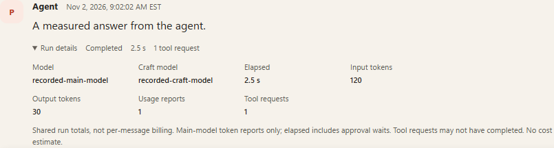</p>
  <p>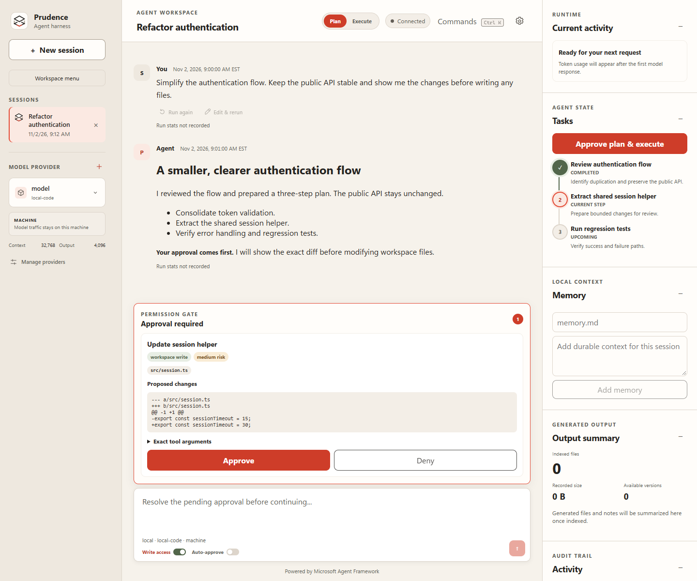</p>
  <p>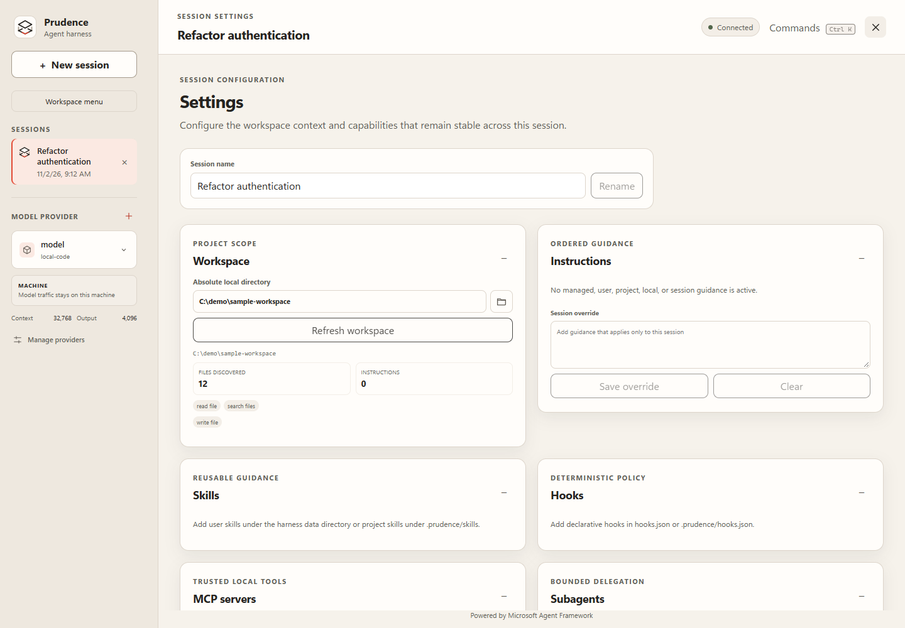</p>
  <p>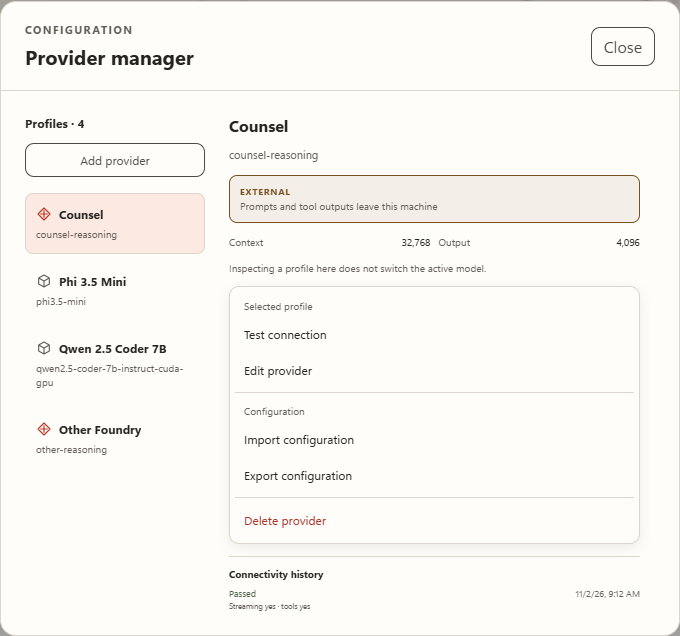</p>
  <p>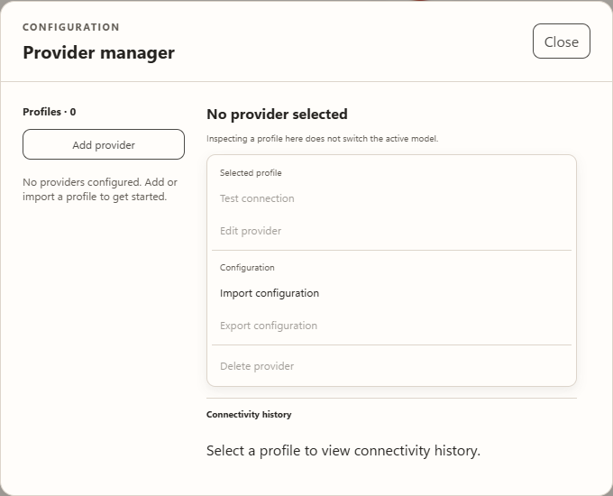</p>
  <p>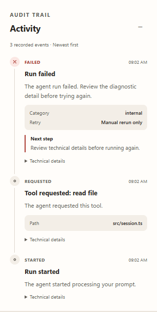</p>
  <p>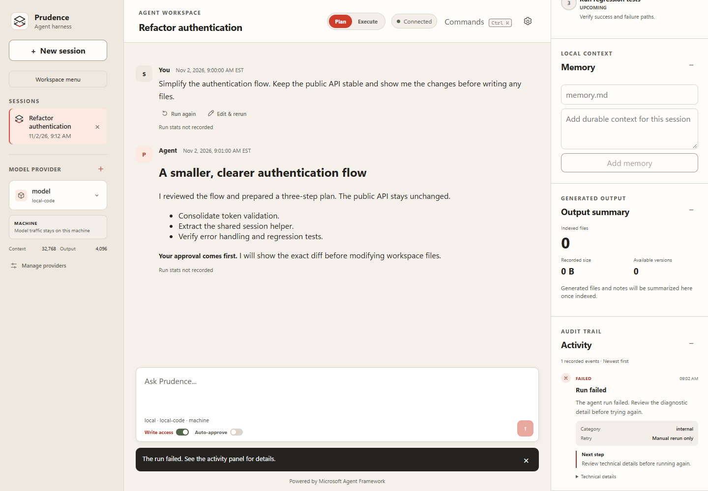</p>
  <p>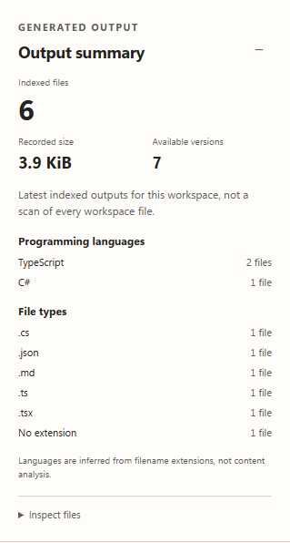</p>
  <p>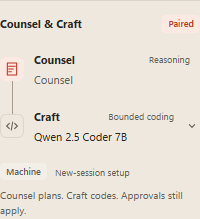</p>
  <p>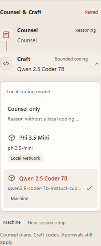</p>
  <p>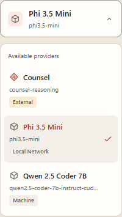</p>
  <p>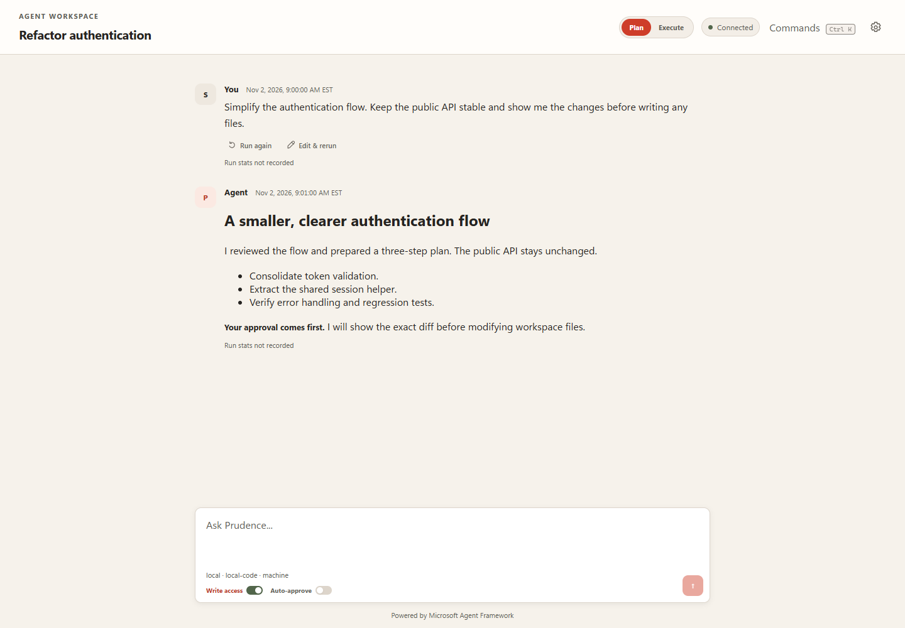</p>
  <p>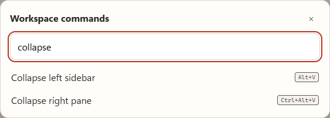</p>
  <p>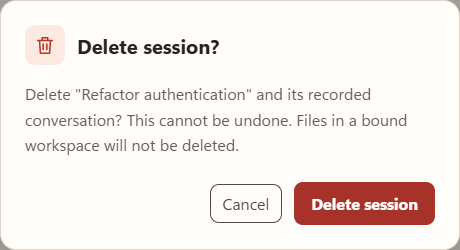</p>
  <p>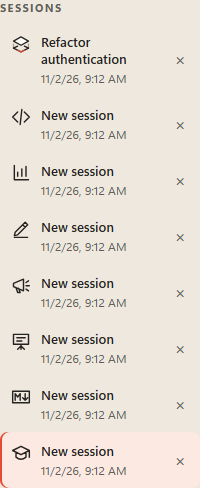</p>
</details>

All screenshots above are real browser captures using synthetic fixtures, without real
workspace content, credentials, or model traffic. See the [frontend guide](frontend/README.md)
for theme tokens, UI checks, and screenshot regeneration.

## Architecture

| Component | Technology | Responsibility |
| --- | --- | --- |
| Frontend | React 19, TypeScript, Vite | Chat, session settings, approvals, tasks, and activity |
| Backend | Python 3.14, FastAPI, Microsoft Agent Framework | Agent orchestration, tools, providers, and persistence |
| Storage | SQLite and workspace files | Local session state, memory, artifacts, and configuration |

## Requirements

- Python 3.14 or later
- [`uv`](https://docs.astral.sh/uv/)
- Node.js with npm
- At least one Microsoft Foundry deployment or OpenAI-compatible local model endpoint
- Azure CLI authentication when using Microsoft Foundry locally

## Quick Start

Start the backend from the repository root:

```powershell
Set-Location .\backend
uv sync
uv run prudence
```

In a second terminal, start the frontend:

```powershell
Set-Location .\frontend
npm ci
npm run dev
```

Open [http://127.0.0.1:5173](http://127.0.0.1:5173). Vite proxies API and WebSocket traffic
under `/api` to the backend at `http://127.0.0.1:8000`.

## Build and Run Locally

Build the frontend once, then run the backend as a local web application:

```powershell
Set-Location .\frontend
npm ci
npm run build

Set-Location ..\backend
uv sync
uv run prudence
```

The backend serves the compiled frontend and opens
[http://127.0.0.1:8000](http://127.0.0.1:8000).

## Provider Profiles

### Microsoft Foundry

Enter the project endpoint and deployment name. Authentication uses `DefaultAzureCredential`; for
local development, sign in with Azure CLI before starting Prudence.

Foundry profiles default to a 32,768-token context window and a 4,096-token output limit. These
values remain editable for each deployment.

### Local Models

Enter an OpenAI-compatible base URL and model name. When the endpoint requires an API key, provide
the name of the environment variable that contains it. Prudence never stores the secret value.

Foundry Local uses its service URL with `/v1`, such as `http://127.0.0.1:<port>/v1`, and the exact
model ID returned by `/v1/models`. Recognized model families use their published token limits;
unknown models must report token-limit metadata through the endpoint.

Every connectivity test records its timestamp, result, streaming support, and tool-calling
capability. The basic probe confirms streamed inference but does not force a tool invocation.

Provider exports are schema-versioned JSON files containing configuration and environment variable
names only. They exclude secrets, database IDs, timestamps, probe history, and session data. A
provider cannot be deleted while a session references it.

## Counsel & Craft

Counsel & Craft pairs a Microsoft Foundry provider with a local provider. Foundry acts as Counsel
and owns planning, reasoning, tools, verification, approvals, and final judgment. The local model
acts as Craft and receives serialized, context-bounded microtasks through `consult_craft`.

Craft accepts one of three request types:

- a complete small file with a target path;
- a named symbol or section from an existing file; or
- a bounded simple response.

Input, output-token, character, and line limits are derived from the Craft profile. Oversized or
incomplete responses fail closed, with one lower-ceiling retry available for incomplete code. Craft
has no Prudence workspace tools or memory and receives only the explicit delegation.

Verified complete files flow to `create_workspace_file`; verified fragments flow to
`replace_workspace_text`. Both remain subject to workspace write access and approval policy.
Code-bearing writes and final code blocks must match verified Craft output or user-provided code.

## Local Data and Workspaces

New installations store application state at `%USERPROFILE%\.prudence\prudence.db`. Set
`PRUDENCE_DATA_DIRECTORY` to choose another local directory.

Existing `%USERPROFILE%\.maf-harness` installations remain in use when `.prudence` does not exist.
The `MAF_HARNESS_DATA_DIRECTORY` environment variable and `maf-harness-api` command remain
compatibility aliases.

Unbound sessions keep memory and artifacts in the application data directory. Binding a workspace
moves durable project scope into that workspace:

| Path | Contents |
| --- | --- |
| `<workspace>\.prudence\memory` | Workspace-shared file memory |
| `<workspace>\.prudence\notes` | Business notes |
| `<workspace>\.prudence\artifacts` | Bounded artifact index metadata |
| `<workspace>\.prudence\settings.json` | Shared workspace settings |

Artifact content is stored in the real workspace files Prudence mutates. When a session is bound,
existing global session memory is copied and verified; conflicts fail without overwriting either
copy.

## Instruction Layers

Instructions merge in ascending precedence. Later sources override earlier sources.

| Priority | Source |
| --- | --- |
| 10 | `%USERPROFILE%\.prudence\managed-instructions.md` |
| 20 | `%USERPROFILE%\.prudence\instructions.md` |
| 30 | `<workspace>\AGENTS.md` |
| 35 | `<workspace>\.github\copilot-instructions.md` |
| 40 | `<workspace>\.prudence\instructions.md` |
| 50 | `<workspace>\.prudence\instructions.local.md` |
| 60 | Workspace or per-session override |

Each active layer is separately inspectable in the UI. Prudence edits only the final override;
managed, user, and project files remain file-managed. Instruction files are UTF-8, limited to
64 KiB, and rejected when their resolved path escapes the declared root.

## Skills, Hooks, and MCP

### Reusable Skills

Skills use a `SKILL.md` file with YAML front matter containing `name` and `description`.

- User skills: `%USERPROFILE%\.prudence\skills\<name>\SKILL.md`
- Project skills: `<workspace>\.prudence\skills\<name>\SKILL.md`

The agent initially receives a bounded skill catalog and loads full instructions through the
read-only `load_skill` tool. Project skills override same-named user or legacy skills.

### Lifecycle Hooks

User hooks live in `%USERPROFILE%\.prudence\hooks.json`; project hooks live in
`<workspace>\.prudence\hooks.json`. Project rules override same-named user or legacy rules.

```json
{
  "hooks": [
    {
      "id": "guard-delete",
      "event": "pre_tool",
      "action": "block",
      "tool_names": ["delete_record"],
      "message": "Deletion is disabled."
    }
  ]
}
```

Supported events are `session`, `prompt`, `pre_tool`, `post_tool`, `compaction`, and `completion`.
Every match is recorded. Blocking rules are allowed before session work, prompts, tools, or
compaction; post-tool and completion hooks are audit-only.

### Local MCP Servers

Prudence supports trusted machine-level stdio MCP servers configured in
`%USERPROFILE%\.prudence\mcp.json`. Workspace files cannot launch MCP processes.

```json
{
  "servers": [
    {
      "id": "account-tools",
      "command": "account-server",
      "args": ["--stdio"],
      "description": "Trusted local account tools.",
      "enabled": true,
      "allowed_tools": ["lookup", "summarize"],
      "always_load": ["lookup"],
      "env_vars": ["ACCOUNT_API_TOKEN"]
    }
  ]
}
```

Servers must be explicitly enabled. Tool names are allowlisted, every exposed MCP tool requires
approval, request timeouts are bounded, and server-initiated model sampling is denied. Processes
run from fixed command and argument arrays without a shell. Environment variable values are never
stored or displayed.

## Constrained Subagents

Binding a workspace enables two delegated agents:

- `explore_workspace` can search and read bounded UTF-8 workspace files.
- `review_workspace` adds bounded Git status, diff, and log inspection when Git metadata exists.

Neither agent receives write tools, test execution, artifacts, memory, skills, hooks, or MCP tools.
Each invocation uses a fresh isolated session with a 60-second timeout, an eight-tool-call limit,
bounded tool and result output, and a 2,048-token model output limit. Invocation status and consumed
budgets are persisted in the session activity trail.

## Validation

Run the backend and frontend checks:

```powershell
Set-Location .\backend
uv run pytest
uv run ruff check .
uv run pyright

Set-Location ..\frontend
npm run lint
npm run build
```

Run the deterministic capability benchmark matrix:

```powershell
Set-Location .\backend
uv run python .\benchmarks\run.py
```

The seven benchmark gates cover feature delivery, exact bug-fix edits, targeted test execution,
repository analysis, hook blocking, permission boundaries, and autonomous iteration budgets. This
suite does not certify live model quality; that requires selected endpoints and authentication.

## Documentation

- [Agent Framework harness capabilities](docs/agent-framework-harness-capabilities.md)

## Contributing

Bug reports and pull requests are welcome. Before opening a pull request:

1. Create a focused branch from `main`.
2. Add or update tests for behavior changes.
3. Run the [validation suite](#validation).
4. Describe the user-visible impact and any persistence or compatibility considerations.

Use [GitHub Issues](https://github.com/stvflowers/maf-harness-1/issues) for reproducible bugs and
focused feature proposals. Open a
[pull request](https://github.com/stvflowers/maf-harness-1/pulls) when the change is ready for
review.

## License

Prudence is available under the [MIT License](LICENSE).
